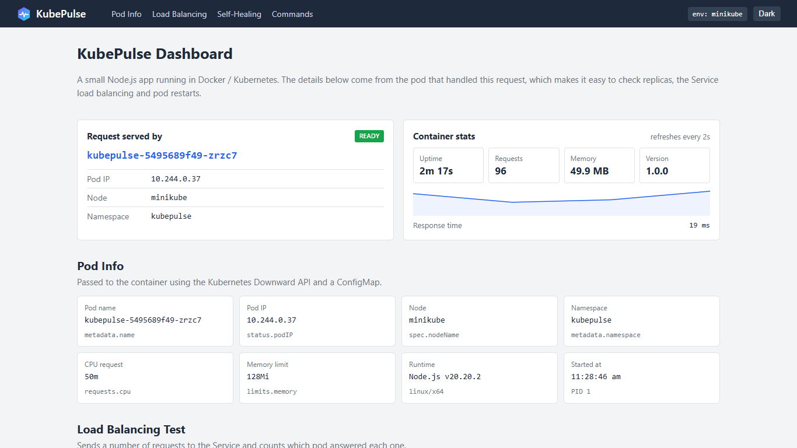

# KubePulse

Containerization & Kubernetes Deployment Challenge (Assignment 2, CND MDM)

KubePulse is a small Node.js web application that is containerized with Docker and deployed on a local Kubernetes cluster (Minikube). The dashboard shows which pod served the request, so load balancing between replicas and pod restarts can be seen in the browser.



## Features

- Shows the pod name, pod IP, node and namespace of the pod that handled the request
- Container stats: uptime, number of requests, memory and response time
- Load balancing test: sends 20/60/150 requests and counts the responses per pod
- Self-healing test: crashes a pod and shows the failover and recovery
- Health endpoints for Kubernetes probes: `/healthz` and `/readyz`
- `/metrics` endpoint in Prometheus format

## Project structure

```
kubepulse/
├── Dockerfile
├── .dockerignore
├── deploy.ps1 / deploy.sh
├── package.json
├── app/server.js
├── public/            (index.html, style.css, app.js)
├── test/server.test.js
├── k8s/
│   ├── 00-namespace.yaml
│   ├── 01-configmap.yaml
│   ├── 02-deployment.yaml
│   ├── 03-service.yaml
│   └── 04-hpa.yaml
├── docs/evidence/     screenshots and command outputs
└── report/            assignment report (PDF)
```

## Run with Docker

```
docker build -t kubepulse:1.0 .
docker run -d -p 8080:8080 --name kubepulse kubepulse:1.0
docker ps --filter "name=kubepulse"
docker logs kubepulse
```

Open http://localhost:8080

The Dockerfile uses a multi-stage build. The tests run in the first stage, and the final image only contains the files needed to run the app. It is based on `node:20-alpine`, runs as the non-root `node` user and has a `HEALTHCHECK`.

## Deploy on Kubernetes (Minikube)

```
minikube start --driver=docker
minikube addons enable metrics-server
minikube image load kubepulse:1.0
kubectl apply -f k8s/
kubectl rollout status deployment/kubepulse -n kubepulse
kubectl get pods -n kubepulse -o wide
kubectl get svc -n kubepulse
minikube service kubepulse-service -n kubepulse
```

Or run `.\deploy.ps1` on Windows (`./deploy.sh` on Linux/macOS).

Deployment details:
- 3 replicas, RollingUpdate strategy (maxSurge 1, maxUnavailable 0)
- requests: 50m CPU / 64Mi memory, limits: 250m CPU / 128Mi memory
- startup, liveness (`/healthz`) and readiness (`/readyz`) probes
- settings from a ConfigMap, pod details from the Downward API
- runs as non-root with a read-only root filesystem
- NodePort Service on port 30080
- HorizontalPodAutoscaler (3 to 6 replicas at 70% CPU)

## Other useful commands

```
kubectl get pods -n kubepulse -w
kubectl scale deployment/kubepulse --replicas=5 -n kubepulse
kubectl set env deployment/kubepulse APP_VERSION=1.1.0 -n kubepulse
kubectl rollout undo deployment/kubepulse -n kubepulse
kubectl logs -l app=kubepulse -n kubepulse --tail=20
kubectl top pods -n kubepulse
```

## Clean up

```
kubectl delete -f k8s/
minikube stop
```
